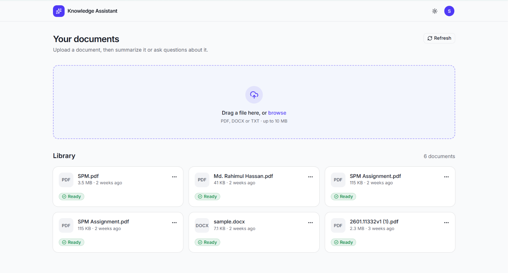
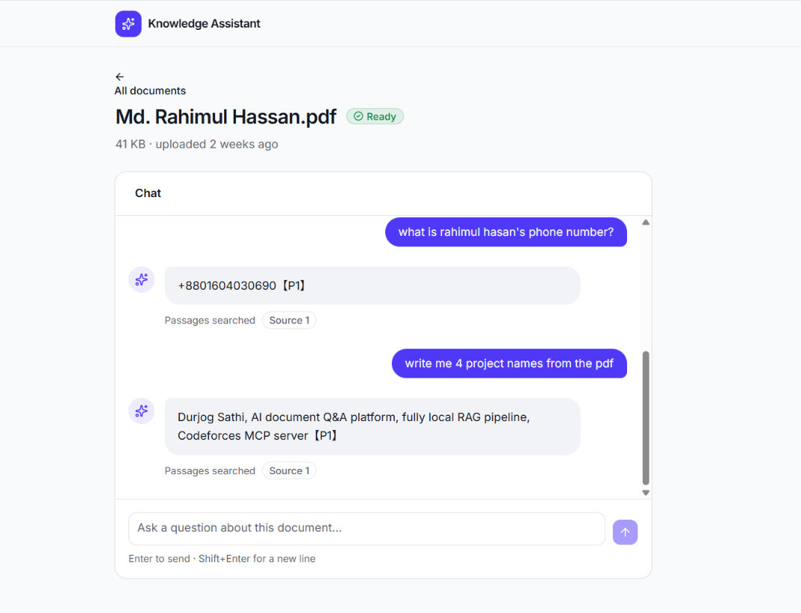
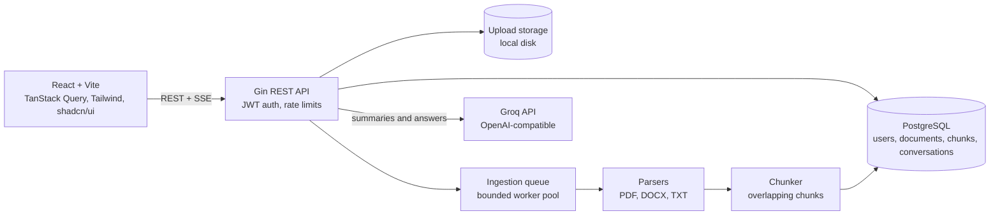
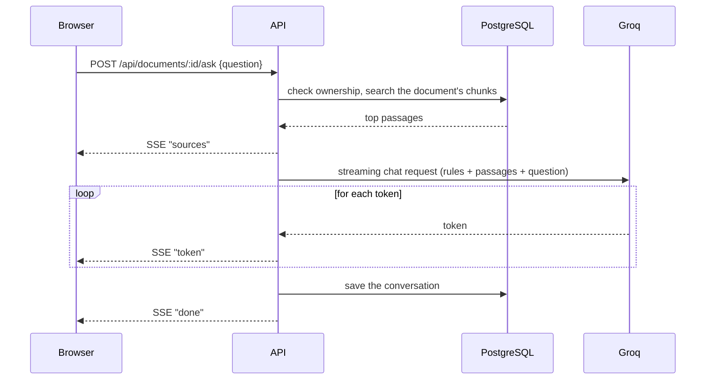

# AI Knowledge Assistant

Upload a PDF, Word or text document, get a summary, and ask questions that are answered **only from that document**, with streamed answers and citations that point back to the passages used.


## Screenshots

| Dashboard | Document view |
|---|---|
|  |  |


## Contents

- [Features](#features)
- [Architecture](#architecture)
- [Quick start](#quick-start)
- [Configuration](#configuration)
- [Using the API](#using-the-api)
- [Design decisions](#design-decisions)
- [Testing](#testing)
- [Project structure](#project-structure)
- [Developer tools](#developer-tools)
- [Troubleshooting](#troubleshooting)
- [Known limitations and roadmap](#known-limitations-and-roadmap)

## Features

**Documents**
- Upload PDF, DOCX and TXT files (10 MB by default). The file type is decided from the file's **content**, never from its name or the browser's Content-Type.
- Ingestion runs in the background on a bounded worker pool: extract text, clean it, split it into overlapping chunks, index it for search. The UI shows `processing`, `ready` or `failed` (with the reason) and updates by itself.
- Every query is scoped to the signed-in user. Someone else's document looks exactly like a missing one.

**Summaries**
- Generated in the background with a map-reduce approach: long documents are summarized in groups, then the summaries are summarized.
- Status tracking (`none`, `processing`, `ready`, `failed`), regeneration, and clear errors when a document is too long or the model is busy.

**Question answering**
- Retrieval over PostgreSQL full-text search with BM25-style ranking, so the model only ever sees the few passages that matter.
- Answers stream token by token over Server-Sent Events.
- Every answer cites the passages it used (`[P1]`, `[P2]`), shown in the UI as clickable source chips with a text preview.
- If nothing in the document matches the question, the app says so **without calling the model**.
- Conversations are saved and paginated. If you stop an answer, the part already written is kept.

**Reliability and protection**
- Per-user rate limits and concurrency caps, a global cap on model calls, and a token-per-minute pacer that keeps the app inside its share of the provider's limit.
- Retries with exponential backoff and jitter, `Retry-After` handling, and fail-fast "busy" responses instead of making users wait.
- Unfinished ingestion and summary jobs are picked up again after a restart.

**Frontend**
- React + TypeScript, light and dark themes, responsive layout (side by side on desktop, tabs on mobile).
- Upload dropzone with instant validation and progress, status polling only while something is processing, loading / empty / error states throughout.

## Architecture



**How a question is answered**



## Quick start

**You need**

- Go 1.26 or newer
- Node.js 20.19+ (or 22.12+)
- Docker (runs PostgreSQL)
- A free [Groq API key](https://console.groq.com)
- Optional but recommended: [poppler](https://poppler.freedesktop.org) for better PDF text extraction (see below)

**1. Clone and configure**

```bash
git clone https://github.com/MdRahimulHassan/AI-Doc-Assistant.git
cd AI-Doc-Assistant
cp .env.example .env          # PowerShell: Copy-Item .env.example .env
```

Open `.env` and set at least:

| Variable | What to put |
|---|---|
| `DB_USER`, `DB_PASSWORD`, `DB_NAME` | Any values you like. Docker creates the database with them |
| `JWT_SECRET` | 32+ random characters, for example the output of `openssl rand -hex 32` |
| `GROQ_API_KEY` | Your Groq key |

**2. Start PostgreSQL**

```bash
docker compose up -d
```

**3. Start the backend** (new terminal)

```bash
cd backend
go run ./cmd/server
```

Database migrations are applied automatically on startup. Check that it is healthy:

```bash
curl http://localhost:5000/health
# {"success":true,"data":{"status":"ok","database":"up"}}
```

**4. Start the frontend** (new terminal)

```bash
cd frontend
cp .env.example .env          # PowerShell: Copy-Item .env.example .env
npm install
npm run dev
```

Open **http://localhost:5173**, create an account, upload a document and ask it something.

> The frontend must run on port **5173**: the backend's CORS setting (`CORS_ORIGINS`) allows only the origins you list. `VITE_API_URL` in `frontend/.env` must point at the backend (`http://localhost:5000` with the default `SERVER_PORT`).

**Better PDF extraction (optional)**

If `pdftotext` (part of poppler) is on your `PATH`, the backend uses it. Otherwise it falls back to a built-in pure-Go extractor, which can glue words together on some PDFs. The startup log says which one is active.

```bash
brew install poppler                # macOS
sudo apt install poppler-utils      # Debian / Ubuntu
choco install poppler               # Windows (or: scoop install poppler)
```

## Configuration

All backend settings are environment variables, validated at startup. A bad value stops the server with a message that lists every problem, and secrets are never printed. Without `GROQ_API_KEY` the server still starts, but the summarize and ask endpoints answer `503`.

| Group | Variable | Default | Meaning |
|---|---|---|---|
| Database | `DB_USER`, `DB_PASSWORD`, `DB_NAME`, `DB_PORT` | (see `.env.example`) | PostgreSQL connection. Docker publishes it on `127.0.0.1` only |
| Server | `SERVER_PORT` | `5000` | HTTP port |
| | `CORS_ORIGINS` | `http://localhost:5173` | Comma-separated explicit origins. `*` is rejected |
| Auth | `JWT_SECRET` | none, required | At least 32 characters |
| | `JWT_TTL` | `24h` | Token lifetime |
| Documents | `UPLOAD_DIR` | `./storage/uploads` | Where files are stored |
| | `MAX_UPLOAD_MB` | `10` | Upload size limit |
| | `INGEST_WORKERS` / `INGEST_QUEUE_SIZE` | `2` / `100` | Ingestion concurrency and queue depth |
| Model | `GROQ_API_KEY` | none | Groq key |
| | `GROQ_MODEL` | `openai/gpt-oss-120b` | Model for answers |
| | `GROQ_SUMMARY_MODEL` | empty | Optional separate model for summaries |
| | `GROQ_TPM_BUDGET` | `6000` | This app's share of the provider's tokens-per-minute limit |
| Q&A | `ASK_TOP_K` | `4` | Passages sent to the model per question |
| | `ASK_CONTEXT_TOKENS` | `3000` | Token budget for those passages |
| | `ASK_MAX_OUTPUT_TOKENS` | `1500` | Longest answer |
| | `ASK_MAX_QUESTION_CHARS` | `1000` | Longest question |
| Limits | `LLM_RATE_PER_MINUTE` | `6` | Ask and summarize requests per user per minute |
| | `LLM_MAX_CONCURRENT_PER_USER` | `2` | Simultaneous model calls per user |
| | `LLM_GLOBAL_CONCURRENCY` | `4` | Simultaneous model calls, all users together |
| | `AUTH_RATE_PER_MINUTE` | `20` | Register and login attempts per minute (per IP) |
| | `UPLOAD_RATE_PER_MINUTE` | `30` | Uploads per minute |
| Summaries | `SUMMARY_GROUP_TOKENS` | `2500` | Size of one group of chunks sent to the model |
| | `SUMMARY_MAX_OUTPUT_TOKENS` | `800` | Longest summary piece |
| | `SUMMARY_MAX_CHUNKS` | `120` | Longer documents answer `DOCUMENT_TOO_LONG` |
| | `SUMMARY_WORKERS` | `1` | Concurrent summary jobs |

**Frontend** (`frontend/.env`)

| Variable | Default | Meaning |
|---|---|---|
| `VITE_API_URL` | none, required | Backend base URL |
| `VITE_MAX_UPLOAD_MB` | `10` | Must match `MAX_UPLOAD_MB`. Used only for instant feedback |
| `VITE_MAX_QUESTION_CHARS` | `1000` | Must match `ASK_MAX_QUESTION_CHARS`. Same purpose |

The backend always has the final say. The frontend copies of the limits only save a round trip.

## Using the API

Every response has the same envelope:

```json
{ "success": true, "data": { } }
```
```json
{
  "success": false,
  "error": {
    "code": "VALIDATION_ERROR",
    "message": "invalid input",
    "details": [{ "field": "email", "message": "a valid email address is required" }]
  }
}
```

| Method | Route | Auth | Purpose |
|---|---|---|---|
| `GET` | `/health` | no | Liveness plus a database check |
| `POST` | `/api/auth/register` | no | Create an account |
| `POST` | `/api/auth/login` | no | Returns a JWT |
| `GET` | `/api/me` | yes | The signed-in user |
| `GET` | `/api/documents` | yes | List your documents, newest first (`limit` up to 100, `offset`) |
| `POST` | `/api/documents` | yes | Upload (multipart field `file`). Returns `202` with status `processing` |
| `GET` | `/api/documents/:id` | yes | Details, including the summary |
| `DELETE` | `/api/documents/:id` | yes | Deletes the document, its chunks, conversations and stored file |
| `POST` | `/api/documents/:id/summarize` | yes | Start (or restart) a summary. Returns `202` |
| `POST` | `/api/documents/:id/ask` | yes | Ask a question. Streams the answer over SSE |
| `GET` | `/api/documents/:id/messages` | yes | Chat history, newest page first (`limit`, `before`) |

**Try it with curl**

```bash
API=http://localhost:5000

# register, then log in
curl -s -X POST $API/api/auth/register -H "Content-Type: application/json" \
  -d '{"email":"you@example.com","password":"a-long-password"}'

TOKEN=$(curl -s -X POST $API/api/auth/login -H "Content-Type: application/json" \
  -d '{"email":"you@example.com","password":"a-long-password"}' \
  | python -c "import sys,json; print(json.load(sys.stdin)['data']['token'])")

# upload, then poll until "status" is "ready"
curl -s -X POST $API/api/documents -H "Authorization: Bearer $TOKEN" -F "file=@./paper.pdf"
curl -s $API/api/documents -H "Authorization: Bearer $TOKEN"

# ask (-N turns off curl's buffering so you see the stream live)
curl -N -X POST $API/api/documents/<DOCUMENT_ID>/ask \
  -H "Authorization: Bearer $TOKEN" -H "Content-Type: application/json" \
  -d '{"question":"What are the main conclusions?"}'
```

**The answer stream**

```text
event: sources
data: {"sources":[{"label":"P1","chunk_index":12,"preview":"..."}]}

event: token
data: {"text":"The study concludes that "}

event: done
data: {"message_id":42,"status":"complete"}
```

- `sources` arrives first. `P1`, `P2`... are the labels the answer cites.
- `done.status` is `partial` if the answer was stopped or hit the output limit.
- `error` events (with a `code`, `message` and sometimes `retry_after_seconds`) are used for failures after streaming has started. Failures before that are ordinary JSON errors with a proper HTTP status.
- Lines starting with `:` are heartbeats and should be ignored.

**Error codes you will meet**

| Code | Meaning |
|---|---|
| `VALIDATION_ERROR` | Bad input. `details` lists the fields |
| `UNAUTHORIZED` / `INVALID_CREDENTIALS` | Missing or expired token / wrong email or password |
| `NOT_FOUND` | Missing, not yours, or not ready, deliberately indistinguishable |
| `FILE_TOO_LARGE`, `UNSUPPORTED_FILE_TYPE`, `NO_FILE` | Upload problems |
| `DOCUMENT_NOT_READY` | The document is still processing or failed |
| `ANSWER_IN_PROGRESS` / `SUMMARY_IN_PROGRESS` | One at a time per document |
| `DOCUMENT_TOO_LONG` | Too many chunks to summarize |
| `RATE_LIMITED` | Too many requests. Check the `Retry-After` header |
| `LLM_UNAVAILABLE`, `SERVICE_UNAVAILABLE` | The model or the ingestion queue is busy or down |

## Design decisions

**Retrieval: full-text search, not embeddings.**
Groq has no embeddings endpoint, and a second service just for vectors would complicate the stack. Documents are split into chunks stored with a generated `tsvector` column and a GIN index. Ranking is BM25-style, computed in SQL: a term counts for more when it is rare across the document's chunks, and repeating it helps less and less. I compared it against Postgres's `ts_rank_cd` on real documents with `cmd/retrievecheck`. The trade-off is that search is lexical, so it can miss synonyms. Hybrid search with `pgvector` is on the roadmap.

**"Not in the document" is answered without the model.**
When no chunk matches, the API replies directly. That saves tokens, avoids a hallucination opportunity, and is honest.

**Chunking with overlap.**
Chunks target about 450 words (never more than 600) with a 55-word overlap, roughly 12%. Splits prefer paragraph and sentence boundaries. The overlap keeps a fact that straddles a boundary retrievable from at least one chunk. Text with no spaces (CJK, base64) is still split.

**Ingestion is asynchronous, and the database is the source of truth.**
Uploads return immediately with status `processing` while a fixed pool of workers does the heavy work, so memory use is predictable however many files arrive. The queue is only a convenience: anything lost in a crash is still `processing` in the database and is queued again at startup. Summary jobs work the same way.

**Summaries are map-reduce.**
A document is cut into groups that fit the model's budget, each group is summarized, and the partial summaries are summarized until one remains. Order is preserved and no text is dropped between layers.

**Streaming with SSE, over `fetch`.**
The server pushes one-way data, so SSE is simpler than WebSockets and works over plain HTTP. The browser's `EventSource` cannot send a POST body or an `Authorization` header, so the client uses `fetch` and reads the response stream itself. Network chunks do not line up with SSE frames (or with multi-byte characters), so the parser buffers and only cuts at a complete blank line. Heartbeats keep idle connections open. If the client leaves, the partial answer is saved.

**Grounding and prompt injection.**
The system prompt requires answers only from the supplied passages, with `[P#]` citations, and treats passage text as untrusted data: instructions found inside a document are never followed. Prompt-like tags inside document text are neutralized before they reach the model. The prompt has a version (`qa-v1`) that is logged with every answer, so a change in behaviour can be traced to a change in wording.

**Protecting a shared model budget.**
Provider limits belong to the whole account, not to one user. A token-bucket pacer and a slot gate cap concurrent calls and tokens per minute across everyone. When capacity is short the API fails fast with `Retry-After` instead of holding a connection open. Transient provider errors are retried with exponential backoff and full jitter.

**Security.**
- Ownership is enforced inside the SQL for every document query, and "not found", "not yours" and "not ready" return the same answer, so document IDs can't be probed.
- File types are sniffed from content (a DOCX must contain `word/document.xml`, since XLSX and PPTX are ZIPs too). Extracted text per document is capped at 5 MiB.
- JWTs are HS256 only, with the algorithm pinned on validation and only `sub`, `iat` and `exp` inside. Passwords are hashed with bcrypt, and the 72-byte bcrypt limit is enforced instead of silently truncating.
- Request bodies are size-limited, CORS lists explicit origins only, and configuration is never logged in a way that could print a secret.

**Frontend.**
- Server state lives in TanStack Query. Polling runs only while a document or summary is actually being processed, gives up after ten minutes, and pauses in background tabs.
- One API layer unwraps the response envelope and turns every failure (HTTP errors, network errors, timeouts, cancellations) into a single typed `ApiError`. Components never see raw responses.
- A rejected token ends the session only if the failing request used the token still in storage, so a wrong password (also a 401) never logs anyone out.
- Model output is rendered as Markdown without raw HTML, so it cannot inject markup.
- After registering, the user is signed in automatically. If that second step fails, they are sent to the login page.

**Known trade-off: the token lives in `localStorage`.**
Any script that runs on the page (an XSS bug) could read it, which an `httpOnly` cookie would prevent. I accepted that for a project with a short token lifetime (24 hours by default), no raw HTML rendering, and automatic sign-out on a 401. The production-grade alternative is an `httpOnly`, `SameSite` cookie with CSRF protection and refresh-token rotation. It needs backend changes and is listed under the roadmap.

## Testing

**Backend**

```bash
cd backend
go test ./...
```

Unit tests cover the parsers, chunker, token manager, auth service, prompt building, summary planning, ingestion queue, rate limiters and the model client (retries, pacing, streaming). Tests that need PostgreSQL are **skipped** unless you provide a database:

```bash
# Create an empty database whose name contains "_test" (the tests wipe its tables).
docker compose exec postgres psql -U <DB_USER> -d postgres -c "CREATE DATABASE ai_doc_assistant_test;"

export TEST_DATABASE_URL="postgres://<DB_USER>:<DB_PASSWORD>@localhost:5432/ai_doc_assistant_test?sslmode=disable"
# PowerShell: $env:TEST_DATABASE_URL = "postgres://..."

go test ./...
```

The tests refuse to run against a database whose name does not contain `_test`, so they can't wipe your development data by accident.

**Frontend**

```bash
cd frontend
npm run lint
npm run build      # type-checks, then builds
```

Automated frontend tests are on the roadmap.

## Project structure

```text
.
├── docker-compose.yml          # PostgreSQL
├── .env.example                # all backend settings, documented above
├── backend/
│   ├── cmd/
│   │   ├── server/             # the API server (wiring, graceful shutdown, startup recovery)
│   │   └── *check/, verify/    # developer tools, see below
│   ├── internal/
│   │   ├── config/             # environment loading and validation
│   │   ├── database/           # pool, embedded SQL migrations
│   │   ├── models/             # domain types and errors
│   │   ├── repository/         # all SQL lives here
│   │   ├── service/            # auth, documents, ingestion, retrieval, summaries, ask
│   │   ├── handler/            # Gin handlers, DTOs, SSE writer
│   │   ├── middleware/         # auth, CORS, request ID, logging, rate limits
│   │   ├── parser/             # PDF (poppler or pure Go), DOCX, TXT, content sniffing, cleaning
│   │   ├── chunker/            # overlap-based chunking
│   │   ├── llm/                # Groq client: streaming, retries, pacer, concurrency slots
│   │   ├── ratelimit/          # keyed limiters and semaphores
│   │   ├── storage/            # file storage (local disk behind an interface)
│   │   └── router/             # route table and integration tests
│   └── pkg/response/           # standard success and error envelopes
└── frontend/
    └── src/
        ├── api/                # axios client, per-resource calls, streaming client
        ├── context/            # auth and theme providers
        ├── hooks/              # data hooks (documents, chat, summaries)
        ├── components/         # UI, with shadcn/ui primitives in components/ui
        ├── pages/              # login, register, dashboard, document view
        ├── lib/                # SSE parser, citations, formatting, validation
        └── types/              # types mirroring the API
```

## Developer tools

Small commands for inspecting each stage of the pipeline on a real document. Most use your development database and `.env`.

| Command | What it does |
|---|---|
| `go run ./cmd/parsecheck <file>` | Shows what the parsers extract from a file |
| `go run ./cmd/ingestcheck <file>` | Runs the ingestion pipeline on a file, then searches the chunks |
| `go run ./cmd/retrievecheck` | Shows what retrieval returns for questions about a document |
| `go run ./cmd/askcheck` | Runs retrieve, prompt and model, and prints the answer, its sources and token estimates |
| `go run ./cmd/summarycheck -dry` | Estimates the cost of summarizing a document before spending anything |
| `go run ./cmd/groqcheck` | Calls Groq once with `Complete` and once with `Stream` |
| `go run ./cmd/verify` | Checks a running server against an expectation matrix (PASS/FAIL) |

Run them from `backend/`, and check each tool's `-h` for its flags.

## Troubleshooting

| Symptom | Cause and fix |
|---|---|
| Browser console shows a CORS error | The page's origin must exactly match `CORS_ORIGINS`. `http://127.0.0.1:5173` is a different origin from `http://localhost:5173` |
| `Port 5173 is already in use` | Another dev server holds it. Close it. Vite is configured not to switch ports, because CORS would then break |
| Backend exits right after start | Read the message: it lists every invalid setting (a short `JWT_SECRET` is the usual one) |
| Ask and summarize return `503` | `GROQ_API_KEY` is empty or invalid |
| A PDF ends as `failed` | It probably has no text layer (a scan). OCR is not supported |
| `RATE_LIMITED` while testing | The defaults are 6 model requests per user per minute. Raise `LLM_RATE_PER_MINUTE` locally if needed |
| Database tests don't run | `TEST_DATABASE_URL` is not set (see [Testing](#testing)) |

## Known limitations and roadmap

- **Scanned PDFs:** only PDFs with a text layer can be processed. No OCR.
- **Search is lexical.** Hybrid search (full-text plus `pgvector` embeddings) would help with synonyms and paraphrases.
- **One document at a time:** cross-document questions are not implemented yet.
- **Library view** shows the 100 most recent documents and has no pagination UI.
- **Auth:** access tokens only (no refresh tokens), stored in `localStorage` (see the trade-off above).
- **Not yet containerized:** `docker compose` runs PostgreSQL only. Dockerfiles for the backend and frontend are planned.
- **Storage** is local disk behind an interface, ready for an S3-compatible implementation.
- **Tests:** frontend tests and a small retrieval-quality evaluation set (questions with known answers) are planned.

## Contributing

Issues and pull requests are welcome. Please run `go test ./...` and `npm run lint` before opening one, and keep commits focused (this repository uses `feat:`, `fix:` and `docs:` style messages).

---

Built by [@MdRahimulHassan](https://github.com/MdRahimulHassan).